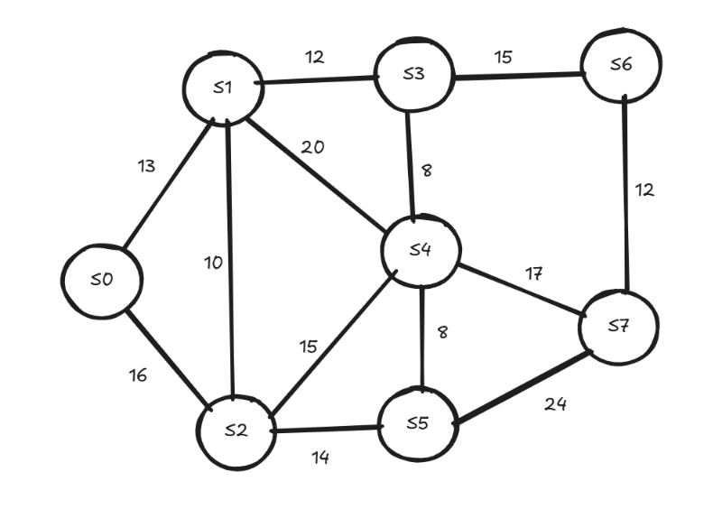

# Atividade-Ponderada-M8-2026-EC-Murilo

Rafael Santana Rodrigues
RA: 510288

D1 = 5, D2 = 1, D3 = 0, D4 = 2, D5 = 8, D6 = 8

Origem: S0 · Destino: S7 (D6 = 8 é par)

|Aresta|Ramal|Fórmula do peso w(e)|Cálculo (RA 510288)|Peso|
|---|---|---|---|---|
|e1|(S0,S1)|w1 = 10 + (D6 mod 5)|10 + (8 mod 5) = 10 + 3|13 km|
|e2|(S0,S2)|w2 = 15 + (D5 mod 7)|15 + (8 mod 7) = 15 + 1|16 km|
|e3|(S1,S2)|w3 = 8 + (D4 mod 4)|8 + (2 mod 4) = 8 + 2|10 km|
|e4|(S1,S3)|w4 = 12 + (D3 mod 6)|12 + (0 mod 6) = 12 + 0|12 km|
|e5|(S2,S4)|w5 = 14 + (D2 mod 5)|14 + (1 mod 5) = 14 + 1|15 km|
|e6|(S2,S5)|w6 = 9 + (D1 mod 6)|9 + (5 mod 6) = 9 + 5|14 km|
|e7|(S3,S4)|w7 = 7 + ((D5 + D6) mod 5)|7 + (16 mod 5) = 7 + 1|8 km|
|e8|(S3,S6)|w8 = 11 + ((D4 + D5) mod 6)|11 + (10 mod 6) = 11 + 4|15 km|
|e9|(S4,S5)|w9 = 6 + ((D3 + D4) mod 4)|6 + (2 mod 4) = 6 + 2|8 km|
|e10|(S4,S7)|w10 = 16 + ((D2 + D3) mod 7)|16 + (1 mod 7) = 16 + 1|17 km|
|e11|(S5,S7)|w11 = 18 + ((D1 + D2) mod 8)|18 + (6 mod 8) = 18 + 6|24 km|
|e12|(S6,S7)|w12 = 9 + ((D5 + D1) mod 5)|9 + (13 mod 5) = 9 + 3|12 km|
|e13|(S1,S4)|w13 = 20 + (D6 mod 4)|20 + (8 mod 4) = 20 + 0|20 km|

## Diagrama topológico



## Matriz de pesos 8×8

Pesos em km. "—" representa NULO 

| |S0|S1|S2|S3|S4|S5|S6|S7|
|---|---|---|---|---|---|---|---|---|
|**S0**|—|13|16|—|—|—|—|—|
|**S1**|13|—|10|12|20|—|—|—|
|**S2**|16|10|—|—|15|14|—|—|
|**S3**|—|12|—|—|8|—|15|—|
|**S4**|—|20|15|8|—|8|—|17|
|**S5**|—|—|14|—|8|—|—|24|
|**S6**|—|—|—|15|—|—|—|12|
|**S7**|—|—|—|—|17|24|12|—|

Simetria: como o grafo é não orientado, M[i][j] = M[j][i] para todo par (M[S1][S4] = M[S4][S1] = 20).

Esparsidade: das 28 posições acima da diagonal, 13 têm peso (os 13 ramais) e 15 são NULO.

## Etapa 2 — Teste de mesa de Dijkstra

Origem: S0 
Destino: S7. 

Valores entre colchetes indicam vértices já fechados.

|Iter.|u|L[u]|L[S0]|L[S1]|L[S2]|L[S3]|L[S4]|L[S5]|L[S6]|L[S7]|Antecessores atualizados|
|---|---|---|---|---|---|---|---|---|---|---|---|
|Inic.|—|—|0|∞|∞|∞|∞|∞|∞|∞|Inicialização na origem S0|
|1|S0|0|[0]|13|16|∞|∞|∞|∞|∞|Ant[S1] = S0 (0 + 13 = 13), Ant[S2] = S0 (0 + 16 = 16)|
|2|S1|13|[0]|[13]|16|25|33|∞|∞|∞|Ant[S3] = S1 (13 + 12 = 25), Ant[S4] = S1 (13 + 20 = 33); S2 não muda (13 + 10 = 23 > 16)|
|3|S2|16|[0]|[13]|[16]|25|31|30|∞|∞|Ant[S4] = S2 (16 + 15 = 31 < 33), Ant[S5] = S2 (16 + 14 = 30)|
|4|S3|25|[0]|[13]|[16]|[25]|31|30|40|∞|Ant[S6] = S3 (25 + 15 = 40); S4 não muda (25 + 8 = 33 > 31)|
|5|S5|30|[0]|[13]|[16]|[25]|31|[30]|40|54|Ant[S7] = S5 (30 + 24 = 54); S4 não muda (30 + 8 = 38 > 31)|
|6|S4|31|[0]|[13]|[16]|[25]|[31]|[30]|40|48|Ant[S7] = S4 (31 + 17 = 48 < 54)|
|7|S6|40|[0]|[13]|[16]|[25]|[31]|[30]|[40]|48|Nenhum; S7 não muda (40 + 12 = 52 > 48)|
|8|S7|48|[0]|[13]|[16]|[25]|[31]|[30]|[40]|[48]|Destino S7 fechado, fim do algoritmo|


Rota ótima: S0 → S2 → S4 → S7, com custo 16 + 15 + 17 = 48 km

## Etapa 3 — Implementação em código e validação

Código: [main.py](main.py) (Python 3.12 + NetworkX 3.6.1)

```bash
pip install networkx
python main.py
```

Estrutura do código:

- TAD `Grafo`: grafo não orientado e ponderado que guarda os ramais em um `networkx.Graph`. Oferece `adicionar_aresta`, `remover_aresta`, `peso` (retorna `None`/NULO quando não há ramal), `vizinhos`, `matriz` e `simetrica`. Pesos negativos ou ausentes são rejeitados ao inserir a aresta.
- `calcular_pesos(ra)`: aplica as 13 fórmulas do enunciado aos dígitos do RA.
- `dijkstra`: versão O(V²) implementada manualmente, com distâncias iniciais infinitas (`math.inf`) e desempate pelo menor índice. Registra a ordem de fechamento e imprime o teste de mesa a cada iteração.
- `prim`: Árvore Geradora Mínima a partir de S0, também implementada manualmente.
- Validação com NetworkX: os resultados próprios são comparados com `nx.single_source_dijkstra` e `nx.minimum_spanning_tree(algorithm="prim")`.

Saída do terminal:

```text
RA 510288 · origem S0 · destino S7

Pesos dos ramais (km):
  e1  (S0, S1) = 13
  e2  (S0, S2) = 16
  e3  (S1, S2) = 10
  e4  (S1, S3) = 12
  e5  (S2, S4) = 15
  e6  (S2, S5) = 14
  e7  (S3, S4) = 8
  e8  (S3, S6) = 15
  e9  (S4, S5) = 8
  e10 (S4, S7) = 17
  e11 (S5, S7) = 24
  e12 (S6, S7) = 12
  e13 (S1, S4) = 20
  Validação: todos os pesos são não negativos

Matriz de adjacência 8×8 (km):
          S0    S1    S2    S3    S4    S5    S6    S7
    S0  NULO    13    16  NULO  NULO  NULO  NULO  NULO
    S1    13  NULO    10    12    20  NULO  NULO  NULO
    S2    16    10  NULO  NULO    15    14  NULO  NULO
    S3  NULO    12  NULO  NULO     8  NULO    15  NULO
    S4  NULO    20    15     8  NULO     8  NULO    17
    S5  NULO  NULO    14  NULO     8  NULO  NULO    24
    S6  NULO  NULO  NULO    15  NULO  NULO  NULO    12
    S7  NULO  NULO  NULO  NULO    17    24    12  NULO
  Simetria M[i][j] = M[j][i]: True

Teste de mesa (Dijkstra):
Iter. u   L[u]  L[S0]  L[S1]  L[S2]  L[S3]  L[S4]  L[S5]  L[S6]  L[S7]  Antecessores atualizados
Inic. —   —     0      ∞      ∞      ∞      ∞      ∞      ∞      ∞      Inicialização na origem S0
1     S0  0     [0]    13     16     ∞      ∞      ∞      ∞      ∞      Ant[S1] = S0, Ant[S2] = S0
2     S1  13    [0]    [13]   16     25     33     ∞      ∞      ∞      Ant[S3] = S1, Ant[S4] = S1
3     S2  16    [0]    [13]   [16]   25     31     30     ∞      ∞      Ant[S4] = S2, Ant[S5] = S2
4     S3  25    [0]    [13]   [16]   [25]   31     30     40     ∞      Ant[S6] = S3
5     S5  30    [0]    [13]   [16]   [25]   31     [30]   40     54     Ant[S7] = S5
6     S4  31    [0]    [13]   [16]   [25]   [31]   [30]   40     48     Ant[S7] = S4
7     S6  40    [0]    [13]   [16]   [25]   [31]   [30]   [40]   48     Nenhum
8     S7  48    [0]    [13]   [16]   [25]   [31]   [30]   [40]   [48]   Nenhum

Custo mínimo acumulado S0 → S7: 48 km
Rota ótima: S0 → S2 → S4 → S7
Ordem de fechamento: S0, S1, S2, S3, S5, S4, S6, S7

Árvore Geradora Mínima (Prim, raiz S0):
  (S0, S1) = 13
  (S1, S2) = 10
  (S1, S3) = 12
  (S3, S4) = 8
  (S4, S5) = 8
  (S3, S6) = 15
  (S6, S7) = 12
  Custo total da MST: 78 km

Validação com NetworkX:
  nx.single_source_dijkstra: 48 km, rota S0 → S2 → S4 → S7
  nx.minimum_spanning_tree (prim): 78 km
  Dijkstra confere: True
  Prim confere: True
```

### Confronto código × mesa

|Item|Teste de mesa (Etapa 2)|Código|Confere|
|---|---|---|---|
|Custo mínimo S0 → S7|48 km|48 km|Sim|
|Rota ótima|S0 → S2 → S4 → S7|S0 → S2 → S4 → S7|Sim|
|Ordem de fechamento|S0, S1, S2, S3, S5, S4, S6, S7|S0, S1, S2, S3, S5, S4, S6, S7|Sim|
|L[v] em cada iteração|Tabela da Etapa 2|Linhas 1 a 8 do console|Sim|
|Antecessores finais|Ant[S1]=S0, Ant[S2]=S0, Ant[S3]=S1, Ant[S4]=S2, Ant[S5]=S2, Ant[S6]=S3, Ant[S7]=S4|Idênticos|Sim|

As distâncias, os antecessores e a ordem de fechamento coincidem exatamente com o teste de mesa. A implementação própria também coincide com a do NetworkX, tanto no Dijkstra (48 km) quanto no Prim (78 km).

## Etapa 4 — Questionário analítico de engenharia

Questão 1 — A distância mínima de S0 até S7 é de 48 km, pela rota S0 → S2 → S4 → S7 (16 + 15 + 17), e os vértices foram fechados pelo Dijkstra na ordem S0, S1, S2, S3, S5, S4, S6, S7.

Questão 2 — Com a queda do ramal e5 = (S2, S4), S4 passa a ser alcançado apenas por S1 (33 km), e a nova rota ótima é S0 → S1 → S4 → S7 (13 + 20 + 17 = 50 km), empatada com S0 → S1 → S3 → S4 → S7 (13 + 12 + 8 + 17 = 50 km), o que representa um acréscimo de 2 km, ou seja, 2/48 ≈ 4,17% sobre o custo original.

Questão 3 — A MST obtida por Prim custa 78 km (ramais S0-S1, S1-S2, S1-S3, S3-S4, S4-S5, S3-S6 e S6-S7), enquanto a soma das distâncias de Dijkstra de S0 a todas as subestações é 203 km (13 + 16 + 25 + 31 + 30 + 40 + 48) e a união das rotas radiais forma uma árvore de 102 km; isso acontece porque o Dijkstra minimiza o custo acumulado da origem até cada destino individualmente, aceitando ramais mais caros para encurtar rotas (como S0-S2 de 16 km no lugar de S1-S2 de 10 km), enquanto o Prim minimiza o custo total de infraestrutura para manter a rede conectada, sem se preocupar com a distância de nenhum vértice até S0.


